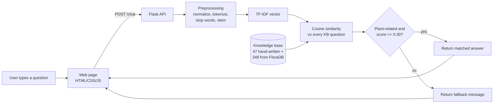

# 🌱 GreenBuddy: Plant Care Assistant

**Your Plants, Our Priority.**
GreenBuddy is an educational NLP mini-project: a chatbot that answers everyday plant-care questions ("Why are my leaves turning yellow?", "Is a peace lily safe for cats?") by finding the closest question in a plant-care knowledge base.

It is a **retrieval-based** chatbot. It does **not** generate text and does not use any AI model or paid API. Every answer it gives already exists in its knowledge base, and when nothing matches well it says so.

---

## 1. Problem statement
Beginner plant owners often don't know the technical words for their plant's problem, so keyword search gives poor results. GreenBuddy lets them ask in plain language and uses classical NLP (text preprocessing, TF-IDF and cosine similarity) to find the most relevant answer.

## 2. Objectives
- Apply text preprocessing (normalization, tokenization, stop-word removal, stemming) using NLTK.
- Represent questions as TF-IDF vectors with scikit-learn and match them with cosine similarity.
- Build a knowledge base from a **real public dataset** plus hand-written answers.
- Reject unrelated questions with a confidence threshold instead of giving wrong answers.
- Measure accuracy on a labelled evaluation set.
- Provide a simple, responsive web interface.

## 3. Features
- Chat page with a typing indicator, quick-question buttons, related-question suggestions and a Clear chat button.
- **"How did I find this?"** panel under each answer that shows the processed words, best match, cosine similarity and threshold. Useful for the viva demo.
- 395 knowledge-base entries: 47 hand-written + 348 generated from the FloraDB dataset (100 houseplants).
- Fallback message for off-topic questions (e.g. "Who won the football match?").
- Clear error message with a **Retry** button if the server is not running.
- Plant-care tips section and an About section explaining the method.
- Automated tests (76) and a reproducible evaluation report.

## 4. Technology stack

| Technology | Why it is used |
|---|---|
| Python 3.10+ | Main language for the NLP and the server |
| Flask | Small web server: serves the page and the `/chat` API |
| Flask-CORS | Allows only local origins to call the API |
| NLTK | Tokenizer, English stop-word list, Porter stemmer |
| scikit-learn | `TfidfVectorizer` and `cosine_similarity` |
| NumPy | Fast array maths on similarity scores |
| HTML, CSS, JavaScript | The web page (no framework, no build step) |
| pytest | Automated tests |

## 5. How it works



**Example** (real output from the code):

| Step | Result |
|---|---|
| Question | `WHY are my plant's leaves turning yellow??` |
| Normalized | `why are my plants leaves turning yellow` |
| Tokens | `why, are, my, plants, leaves, turning, yellow` |
| After stop-word removal | `plants, leaves, turning, yellow` |
| After stemming | `plant, leaf, turn, yellow` |
| Best match | "Why are my plant's leaves turning yellow?" with cosine similarity **1.000** |

More detail: [docs/PROJECT_REPORT.md](docs/PROJECT_REPORT.md) (also as a PDF) and [docs/DEMO_AND_VIVA.md](docs/DEMO_AND_VIVA.md).

## 6. Dataset
- **FloraDB Houseplant Care & Pet-Toxicity Dataset (free sample)** by dataengineered.io, with 100 houseplants. It's available on [Hugging Face](https://huggingface.co/datasets/Ichlibitiche/floradb-houseplants-care-sample) and [Kaggle](https://www.kaggle.com/datasets/dataengineered/floradb-houseplants-care-sample). License: **CC BY-NC 4.0** (attribution, non-commercial; fine for a college project).
- Columns used: common and scientific name, light level and lux range, watering interval (days), temperature range, humidity, ASPCA dog/cat toxicity, and the dataset's own quality flags (`care_confidence`, `toxicity_status`).
- `backend/scripts/build_knowledge_base.py` turns each table row into question/answer entries (care summary, light, watering, pet safety) and also builds lists such as "pet-safe plants" and "low-light plants".
  - Plants whose care data is marked low-confidence only get a pet-safety entry, and an "unknown" toxicity is never reported as safe.
- The CSV is included in `backend/data/raw/`, so no download is needed. The dataset card is in the same folder.

## 7. Folder structure

```
GreenBuddy/
├── backend/
│   ├── app.py                      # Flask server: web page + API
│   ├── config.py                   # thresholds, port, file paths
│   ├── requirements.txt            # runtime libraries
│   ├── requirements-dev.txt        # + pytest, markdown (tests and report)
│   ├── nlp/
│   │   ├── preprocess.py           # normalize -> tokenize -> stop words -> stem
│   │   ├── synonyms.py             # "money plant" -> "pothos", spelling fixes
│   │   ├── chatbot.py              # TF-IDF + cosine similarity + fallback
│   │   └── evaluator.py            # accuracy report and threshold calibration
│   ├── knowledge_base/
│   │   ├── __init__.py             # loads and validates the JSON files
│   │   ├── plant_care_core.json    # 47 hand-written entries
│   │   └── plant_care_generated.json  # 348 entries built from FloraDB
│   ├── data/raw/                   # FloraDB CSV + dataset card
│   ├── scripts/                    # build_knowledge_base.py, download_dataset.py
│   ├── evaluation/                 # eval_dataset.json + reports/
│   └── tests/                      # pytest tests
├── frontend/
│   ├── index.html                  # the page
│   ├── styles.css
│   ├── app.js                      # sends questions to /chat, shows answers
│   └── favicon.svg
└── docs/
    ├── PROJECT_REPORT.md                # report text (source)
    ├── GreenBuddy_Project_Report.pdf    # report in the RVITM mini-project format
    ├── PRESENTATION_PREP.md / GreenBuddy_Presentation_Prep.pdf   # plain-language prep guide
    ├── DEMO_AND_VIVA.md                 # demo script + viva questions
    └── report/                          # scripts + styles that build the PDFs
```

## 8. Setup and running

### Prerequisites
- **Python 3.10 or newer.** On a Mac, check with `python3 --version`. If it's missing, install it from [python.org](https://www.python.org/downloads/) or with Homebrew (`brew install python`).
- No Node.js, database, account or API key is needed.

### macOS / Linux

Open **Terminal** in the project folder and run:

```bash
cd backend
python3 -m venv .venv            # create a virtual environment (first time only)
source .venv/bin/activate        # activate it (every new terminal)
pip install -r requirements.txt  # install libraries (first time only)
python3 app.py                   # start GreenBuddy
```

Then open **http://127.0.0.1:5001** in your browser. Stop the server with `Ctrl + C`.

### Windows (PowerShell)

```powershell
cd backend
python -m venv .venv
.venv\Scripts\Activate.ps1
pip install -r requirements.txt
python app.py
```

### Optional: full NLTK data
The app works without downloading anything extra. NLTK's built-in regex tokenizer and a bundled copy of NLTK's English stop-word list are used automatically. If you want NLTK's `word_tokenize` and stop-word corpus to be used instead:

```bash
python3 -m nltk.downloader punkt_tab stopwords
```

## 9. API

| Method | Path | Purpose |
|---|---|---|
| GET | `/` | The chat web page |
| GET | `/health` (alias `/api/health`) | Server status and number of entries |
| GET | `/api/topics` | Topics with entry counts and examples |
| POST | `/chat` (alias `/api/chat`) | Ask a question |

```bash
curl -X POST http://127.0.0.1:5001/chat \
     -H "Content-Type: application/json" \
     -d '{"question": "How often should I water a money plant?"}'
```

Response (real output, shortened):

```json
{
  "answer": "FloraDB gives a typical interval of about every 7 days for the Golden Pothos. Use that only as a rough guide: water when the top 2-5 cm of soil feels dry. ...",
  "topic": "plant_profiles",
  "topic_label": "Plant Profiles",
  "matched_question": "How often should I water a Golden Pothos?",
  "similarity": 1.0,
  "confidence": "high",
  "fallback": false,
  "source": "floradb",
  "related_questions": ["How do I care for a Golden Pothos?", "..."]
}
```

- Add `"debug": true` to the request to also get the preprocessing steps and the top 3 matches.
- Invalid input returns HTTP 400 with `{"error": {"code": "...", "message": "..."}}`. Codes: `MISSING_QUESTION`, `INVALID_QUESTION`, `QUESTION_TOO_LONG` (over 500 characters), `INVALID_JSON`. Sending something other than JSON returns 415.

## 10. Testing and evaluation

```bash
cd backend
source .venv/bin/activate
pip install -r requirements-dev.txt
python3 -m pytest                      # 76 tests
python3 -m nlp.evaluator               # writes evaluation/reports/evaluation_report.md
python3 scripts/build_knowledge_base.py   # rebuild entries from the CSV (output is identical)
```

To rebuild the PDFs after editing the Markdown (needs Google Chrome or Edge), run these from the project root with the venv active:

```bash
python3 docs/report/build_report.py   # docs/GreenBuddy_Project_Report.pdf
python3 docs/report/build_prep.py     # docs/GreenBuddy_Presentation_Prep.pdf
```

**Evaluation results** (held-out test split: 40 questions, 28 plant-care + 12 unrelated, threshold 0.30):

| Metric | Result |
|---|---|
| Top-1 topic accuracy (plant questions) | 85.7% (24/28) |
| Exact entry accuracy (plant questions) | 78.6% (22/28) |
| Unrelated questions correctly rejected (fallback recall) | 100% (12/12) |
| Unrelated questions answered by mistake | 0 |
| Overall accuracy | 85.0% |

The threshold was chosen on a separate calibration split. The dataset is small and written by the project author, so treat these numbers as an indication, not a guarantee. See [the full report](backend/evaluation/reports/evaluation_report.md).

## 11. Limitations
- TF-IDF matches **words**, not meaning: "small black bugs flying around" fails to match "fungus gnats" because they share no words.
- The answers are only as good as the knowledge base; questions outside it get the fallback.
- One question at a time: the bot has no memory of earlier messages.
- The dataset's care values are typical guides, not exact rules, and symptoms can have several causes. GreenBuddy is not professional or veterinary advice.

## 12. Troubleshooting

| Problem | Fix |
|---|---|
| `command not found: python` (Mac) | Use `python3` and `pip3`, or activate the venv first. |
| `Address already in use` / port busy | Another program is on port 5001. Run `GREENBUDDY_PORT=5002 python3 app.py` and open `http://127.0.0.1:5002`. (We avoid port 5000 because macOS uses it for AirPlay Receiver.) |
| Page says "Offline: start the backend" | The Flask server isn't running. Start it with `python3 app.py`. |
| Opening `index.html` by double-clicking doesn't work | Open `http://127.0.0.1:5001` instead; the page must be served by Flask. |
| `ModuleNotFoundError: flask` | Activate the venv (`source .venv/bin/activate`) and `pip install -r requirements.txt`. |
| NLTK download fails with an SSL error on Mac | It's optional. To fix it anyway, run `/Applications/Python\ 3.x/Install\ Certificates.command` (use your version number). |

## 13. Future enhancements
- Add more hand-written entries for questions that currently fall back.
- Use word embeddings or a small sentence-embedding model to match meaning, not just words.
- Remember the plant being discussed for follow-up questions.
- Let users rate answers to find gaps in the knowledge base.

---
*Data: FloraDB Houseplant Care & Pet-Toxicity Dataset (sample), © dataengineered.io, CC BY-NC 4.0. Toxicity information is ASPCA-based and informational only; contact a vet if a pet eats a plant.*
*Photos: Alina Kakshapati and Tawhid Sadman, [WordPress Photo Directory](https://wordpress.org/photos/) (CC0). Fonts: Fraunces and DM Sans (SIL Open Font License), bundled in `frontend/fonts/`.*
